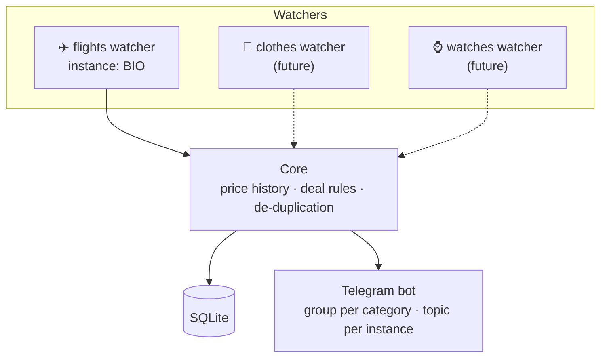

# bilbao-flight-deals

A self-hosted deal hunter that watches flight prices departing from **Bilbao (BIO)** and sends an alert to **Telegram** when a fare is clearly cheaper than usual.

It runs 24/7 on a free cloud server, provisioned with **Terraform** and orchestrated with **Kubernetes (k3s)**, with every component packaged as a **Docker** image.

> **Status:** ✅ Phase 0 (setup) done · 🚧 Phase 1 (local flights watcher) in progress. See the [roadmap](docs/roadmap.md).

---

## What it does

1. **Watches** round-trip fares from Bilbao to any destination, several times a day.
2. **Filters** them: direct or 1-stop flights, departing between 7 days and 6 months ahead, and a trip length that fits the distance (2–7 nights for flights up to 3 h, 3–10 up to 6 h, 6–21 beyond).
3. **Remembers** every price it sees, so it learns what "normal" looks like for each route.
4. **Decides** whether a fare is a deal, with stricter rules for short notice:

   | Departure | Alert if | Label |
   |---|---|---|
   | 30 days – 6 months | ≥ 30% below usual **or** ≤ €40 per person | ✈️ Deal |
   | 7 – 29 days | ≥ 50% below usual **or** ≤ €30 per person | ⚡ Super deal · last minute |
5. **Alerts** on Telegram with the price, the drop and a link — without repeating itself unless the price drops further.
6. **Summarises** the best fares every Sunday.

Example alert:

```
✈️ Deal · Bilbao → Rome (FCO)
🛫 Out: Mon 14 Dec, 06:35 · 2 h 25 min · direct
🛬 Back: Fri 18 Dec, 21:10 · 2 h 30 min · direct
🌙 4 nights · airline Ryanair
💶 49 € per person · 98 € for 2
📉 42% below usual (85 €)
⏳ Departs in 48 days
🔎 Indicative price from recent searches: check it before buying.
View flight
```

Messages can be in English or Spanish (`telegram.language` in the instance config).

## Architecture

The system is split into **watchers** (one per category, e.g. flights, clothes, watches) that share a common **core**. Each watcher can run several **instances** with different settings — for example *flights from Bilbao*, *flights from Madrid* — all from the same image, each defined by a config file.



More detail in [docs/architecture.md](docs/architecture.md).

## Tech stack

| Area | Tool |
|---|---|
| Language | Python 3.13 · [uv](https://docs.astral.sh/uv/) workspace · pydantic |
| Quality | Ruff (lint and format) · mypy (strict) · pytest |
| Containers | Docker, GitHub Container Registry |
| Orchestration | Kubernetes (k3s) |
| Infrastructure as Code | Terraform (Oracle Cloud Always Free) |
| CI/CD | GitHub Actions |
| Data | SQLite (Phase 1), PostgreSQL later |
| Flight prices | Travelpayouts / Aviasales Data API |
| Notifications | Telegram Bot API |

Everything runs on free tiers.

## Getting started

1. Install the tools: [docs/development-setup.md](docs/development-setup.md)
2. Set up Telegram: [docs/telegram-setup.md](docs/telegram-setup.md)
3. Get a price API token: [docs/price-source.md](docs/price-source.md)
4. Create the cloud account: [docs/oracle-cloud-setup.md](docs/oracle-cloud-setup.md)
5. Copy `.env.example` to `.env` and fill in the values
6. Install and check:

```bash
make install   # creates .venv with Python 3.13 and all packages
make check     # lint, type checks and tests
make search    # list current fares from Bilbao that pass the filters
make dry-run   # full run, prints the Telegram messages without sending or storing
make run       # full run: records price history and sends alerts
```

Run `make help` to list all tasks.

## Repository layout

```
.
├── config/watchers/   # One YAML file per watcher instance (e.g. flights-bio.yaml)
├── core/              # Python package dealhunter-core: config, price history, deal rules, notifier
├── watchers/flights/  # Python package flights-watcher: fetches fares from the price API
├── infra/terraform/   # Cloud infrastructure (network, VM)
├── infra/k8s/         # Kubernetes manifests
├── docs/              # Architecture, roadmap, setup guides and price source notes
└── .github/           # Pull request template (CI workflows later)
```

Root files: `pyproject.toml` (uv workspace and tool settings), `uv.lock` (pinned dependency versions), `.python-version`, `Makefile` (common tasks), `.env.example` (required environment variables), `.gitignore` (files never tracked), `.gitattributes` (LF line endings), `.editorconfig` (shared formatting), `CONTRIBUTING.md` (workflow and conventions), `LICENSE`.

## Contributing

See [CONTRIBUTING.md](CONTRIBUTING.md) for branch, commit and pull request conventions.

## License

[MIT](LICENSE)
