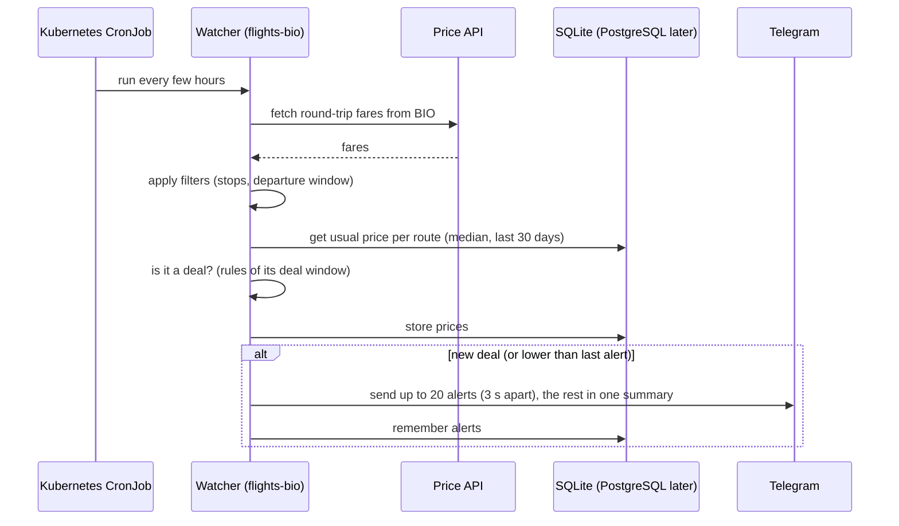
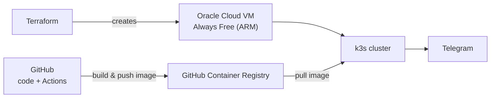

# Architecture

## Concepts

| Concept | What it is | Example |
|---|---|---|
| **Watcher** | A component that looks for deals in one category. One Docker image per watcher. | `flights`, later `clothes`, `watches` |
| **Instance** | The same watcher running with its own settings. One config file each. | `flights-bio`, later `flights-mad`, `flights-bcn` |
| **Core** | Shared logic used by every watcher. | Price history, deal rules, de-duplication, Telegram |

Adding a new **instance** means adding a YAML file — no new code.
Adding a new **watcher** means adding a new folder under `watchers/` that implements the same small interface.

## Flow

## Telegram layout

Telegram groups can have **topics**, but topics cannot be nested. Three levels are mapped like this:

| Level | Telegram | Example |
|---|---|---|
| Whole system | Chat folder | "Deals" |
| Watcher | Group (supergroup with topics) | "Flights" |
| Instance | Topic inside the group | "Bilbao" |

Display names are free text. One bot serves every group. Each instance config names the environment variables that hold its group and topic IDs (`chat_id_env`, `topic_id_env`), so no IDs live in the repository. Setup steps: [telegram-setup.md](telegram-setup.md).

## Where it runs

## Design notes

- **Free by design.** Oracle Cloud Always Free ARM (one 1 OCPU / 6 GB server; the free allowance is 2 OCPU / 12 GB), Travelpayouts free data API, GitHub free tier.
- **ARM images.** The server is ARM, so images are built for `linux/arm64` (and `amd64` for local use).
- **Prices are cached, not live.** The free price API returns recently searched fares (kept 2–7 days). Good for spotting drops; the price may change when opening the link. Coverage is strong 1–2 months ahead and thin further out — see [price-source.md](price-source.md).
- **Deal windows.** Each instance defines windows of departure dates with their own rules (e.g. regular 30–180 days, last minute 7–29 days with stricter thresholds).
- **Usual price.** Median of the route's prices seen in the last 30 days (needs at least 5). The median ignores one-off outliers better than the mean. A price is compared with the history *before* it is recorded.
- **Cold start.** The first run is a warm-up: it records prices and only sends a start message. Until a route has enough history, the per-person price rules do most of the work.
- **Alert volume.** One alert per flight, at most 20 per run as a safety cap (best drop first, then cheapest); any others go in a single summary message. Messages are sent 3 seconds apart to stay under Telegram's limit of about 20 messages per minute in a group. An item is not alerted again unless its price drops further.
